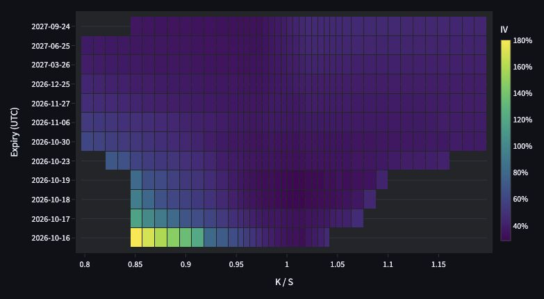
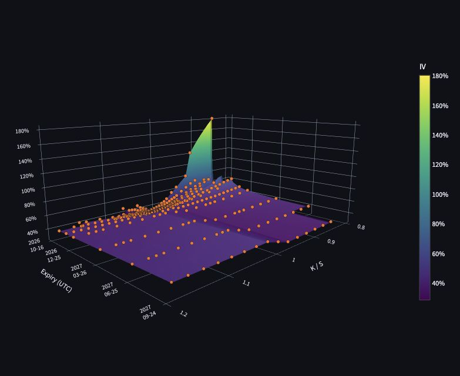
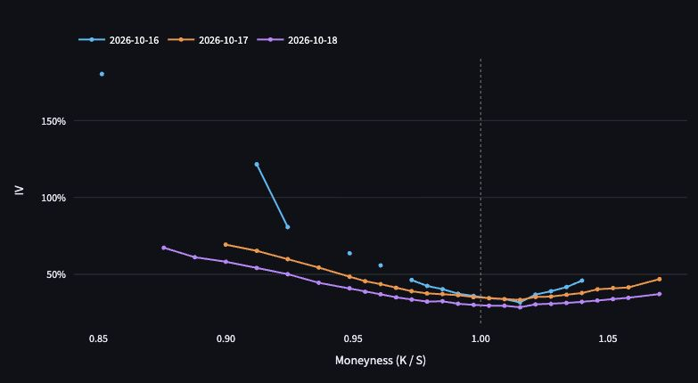
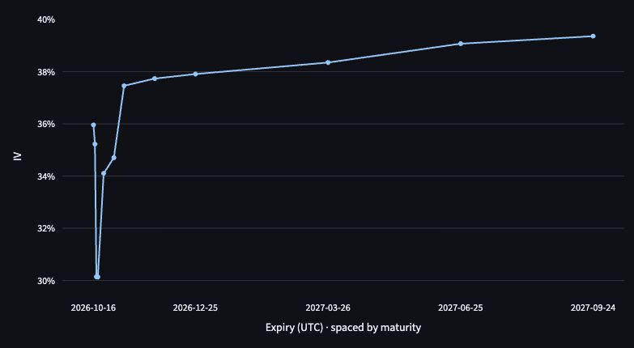

# implied-vol-surface

A small personal quant library for learning and building implied-volatility tooling from first principles.

`implied-vol-surface` provides Black-Scholes pricing helpers, implied-volatility root finding, surface construction, interpolation, and Deribit/Bybit option-chain inputs.

The implied-volatility root-finding logic is implemented without `scipy.optimize`.

## Status

This is an early local package in a personal quant-library ecosystem. It is useful for experiments and for feeding downstream projects, but it is not production trading infrastructure and is not financial advice.

## What It Does

- Prices European calls and puts with Black-Scholes.
- Solves implied volatility with Newton-Raphson and bisection fallback.
- Builds a 2D IV surface from a grid of option prices.
- Interpolates IV inside an expiry/strike grid with bilinear interpolation.
- Fetches and parses Bybit option-chain ticker data into a DataFrame, keeping market quotes separate from exchange mark values.
- Adapts Deribit BTC inverse-option snapshots to USD premiums using a captured BTC/USD index.
- Converts usable option-chain mid prices into the expiry/strike grid used by the surface builder.
- Combines aligned Call and Put surfaces with a spot-based, auditable selection rule.

## Dashboard preview

These charts come from the offline dashboard using the checked-in Deribit BTC
snapshot captured on **2026-10-15 at 15:18:14 UTC**, with a **0.00%** risk-free
rate. Open the [offline dashboard](#offline-dashboard) to explore the charts and
their tooltips interactively.

### Combined IV heatmap

Color shows IV across spot moneyness (`K / S`) and expiry. This is Surface mode
in the Core range (`0.8–1.2`): observed values are preserved, supported gaps are
filled by 2D total-variance interpolation, and unsupported cells remain blank.
Expiry rows have equal height and are ordered by maturity.



### 3D surface

The same interpolated values are shown in 3D, with numerical time to expiry
controlling maturity spacing. Orange points show the original observed Combined
IV; the surface is an interpolated display rather than an arbitrage-free fit.



### IV smiles

Compare observed Combined IV across strikes for selected expiries. The example
uses the first three usable expiries; each curve retains its missing-value gaps
and does not use the surface interpolation.



### ATM term structure

Compare observed near-ATM IV across all expiries. Each expiry uses the nearest
finite Combined IV within 2% of spot, averaging equally near strikes. Dates are
spaced by numerical maturity; expiries without an eligible proxy remain gaps.



## Module Boundaries

- `iv_surface.fetcher` owns Bybit HTTP access, raw snapshot envelopes, and
  parsing exchange responses into the canonical option-chain DataFrame.
- `iv_surface.deribit` validates frozen BTC inverse-option snapshots and adapts
  their metadata, BTC quotes and index to the same chain model.
- `iv_surface.surface_builder` converts that canonical chain into option-price
  grids and side-specific or Combined IV surfaces.
- `iv_surface.solver` owns Black-Scholes pricing, IV root finding, grid solving,
  and interpolation.
- `iv_surface.surface_transforms` reshapes IV surfaces and selects the bounded
  ATM proxy without requiring Plotly.
- `iv_surface.visualization` constructs Plotly figures from prepared frames.

## Core Data Shape

IV surface arrays use expiry rows and strike columns:

```text
iv_surface.shape == (len(expiries), len(strikes))
iv_surface[i, j] == IV at expiries[i], strikes[j]
```

Example layout:

```text
              K=90   K=100   K=110
T=0.10        0.18    0.20    0.22
T=0.25        0.19    0.21    0.23
T=0.50        0.20    0.22    0.24
```

Accordingly, the surface APIs take `expiries` before `strikes`, and interpolation uses `target_T` and `target_K`.

## Installation

Install locally in editable mode:

```bash
pip install -e .
```

For development dependencies:

```bash
pip install -e ".[dev]"
```

## Offline dashboard

From the repository root:

```bash
pip install -e ".[dashboard]"
python -m streamlit run app.py
```

The dashboard defaults to the checked-in Deribit BTC snapshot. The sidebar
**Data source** selector also opens the original Bybit snapshot. Both run offline;
the header identifies the selected exchange and capture time. Switching sources
resets the smile expiry checklist to the first three usable expiries.

The dashboard shows a Combined IV heatmap, 3D surface, IV smiles, and ATM term
structure. IV smiles use original observed
values across all strikes, with an independent expiry checklist. The ATM view
uses every expiry and selects the nearest finite Combined IV within 2% of spot,
averaging equally near strikes. Expiries without an eligible proxy remain gaps;
selection details show their status. Numerical maturity (`tau`) controls spacing.
All chart tooltips show source expiry dates in UTC, time to expiry in days
(`tau × 365.25`), and `tau` in years, using the frozen snapshot time. The 3D
view switches to a compact layout when its available width is below 700px.

The default `0.80 <= K / S <= 1.20` surface fills missing
grid cells with 2D piecewise-linear total-variance interpolation. It converts
observed IV to `w = IV² × tau`, interpolates across spot moneyness and numerical
`tau`, then converts back with `IV = sqrt(w / tau)`. Both axes are scaled to
their observed min/max ranges before triangulation. Support uses only original
finite observations inside the selected display range; observed values stay
unchanged and cells outside their convex hull remain missing. The Heatmap can switch back to unfilled
Observed values, and both charts can switch to an extended
`0.70 <= K / S <= 1.30` range. Hover distinguishes Observed, Interpolated, and
Missing cells, with `2D linear total variance` as the interpolated value source.
`interpolate_surface_2d()` in `surface_transforms.py` performs this operation
independently of the UI and retains original IV in `observed_iv`, quote
provenance in `source`, and the display method in `interpolation_method`.
Fewer than three non-collinear observations leave missing cells unfilled.
This fills the existing grid rather than adding dense display points.
The sidebar rate is in percent per year, continuously
compounded; changing it recomputes IV from the same frozen bid/ask quotes.

### Deribit input

`data/deribit_btc_options_snapshot.json` preserves the raw responses from
[`public/get_instruments`](https://docs.deribit.com/api-reference/market-data/public-get_instruments),
[`public/get_book_summary_by_currency`](https://docs.deribit.com/api-reference/market-data/public-get_book_summary_by_currency),
and [`public/get_index_price`](https://docs.deribit.com/api-reference/market-data/public-get_index_price).
The version-1 envelope records `exchange: deribit`, `currency: BTC`, `base_url`,
UTC capture start/end and a `requests` list containing each endpoint, parameters,
UTC receive time and unchanged JSON-RPC response. The requests are sequential,
so the envelope records a capture interval rather than an atomic exchange snapshot.
Recurring historical collection belongs to the separate collector project.

The adapter accepts BTC inverse options with one-BTC contract size. Instrument
metadata supplies strike, option type and expiration timestamp. It retains
instruments with missing books as missing quotes and rejects ambiguous identities
or unsupported currencies. A valid mid requires positive, finite, uncrossed
bid and ask; mark and exchange-provided mid values never fill absent quotes.

[BTC inverse-option premiums are quoted in BTC](https://support.deribit.com/hc/en-us/articles/31424939096093-Inverse-Options).
The adapter multiplies bid/ask premiums by the captured BTC/USD index to obtain
USD per BTC, retaining BTC fields as `bid_price_btc`, `ask_price_btc`,
`mid_price_btc` and `mark_price_btc`. That same index is the shared spot.
Source expiry timestamps and the frozen capture end determine `tau` on the
365.25-day basis. `mark_iv` is normalized from percent to decimal.

Computed IV uses this repository's spot Black-Scholes solver and selected rate.
Deribit's expiry-specific `underlying_price` is retained as comparison metadata;
it is not substituted for spot. Computed IV therefore need not equal exchange
mark IV. Combined-IV, interpolation and ATM selection rules are shared with Bybit.

## Quick Example

```python
import numpy as np

from iv_surface.solver import bs_price, build_surface, interpolate_iv

spot_price = 100
r = 0.03
sigma = 0.20

expiries = [0.10, 0.25, 0.50]
strikes = [90, 100, 110]

option_price_grid = np.array([
    [bs_price(spot_price, K, T, r, sigma, "call") for K in strikes]
    for T in expiries
])

iv_surface = build_surface(
    option_price_grid, spot_price, expiries, strikes, r, flag="call"
)
iv = interpolate_iv(iv_surface, expiries, strikes, target_T=0.18, target_K=97)

print(iv_surface)
print(iv)
```

## API

### `bs_price(spot_price, K, T, r, sigma, flag, t=0)`

Returns the Black-Scholes price for a European call or put.

### `solve_iv(option_price, spot_price, K, T, r, flag, sigma_low=1e-6, sigma_high=10.0)`

Returns implied volatility for a single option price. Raises `ValueError` for invalid inputs, expired options, or prices outside the bracket implied by the sigma bounds.

### `build_surface(option_price_grid, spot_price, expiries, strikes, r=0, flag="call")`

Returns a 2D NumPy array of implied volatilities with shape `(n_expiries, n_strikes)`. Cells that cannot be solved are filled with `NaN`.

### `interpolate_iv(iv_surface, expiries, strikes, target_T, target_K)`

Returns bilinearly interpolated IV at the target `(T, K)`. Raises `ValueError` if the target point is outside the grid or if the grid is not valid.

### `fetch_chain(underlying="BTC")`

Fetches Bybit option tickers for an underlying and returns a tidy pandas DataFrame with parsed symbol fields, bid/ask prices, bid/ask IVs, mid price, mark price, mark IV, index price, and time to expiry.

`mid_price` is computed only from valid positive bid/ask quotes. If the bid/ask quote is not usable, `mid_price` is `NaN` and `quote_source` is `"none"`; the fetcher does not silently fall back to `mark_price`.

### `prepare_surface_inputs(chain, flag="call")`

Filters a fetched option-chain DataFrame to usable bid/ask mid prices and returns `option_price_grid`, `spot_price`, `expiries`, and `strikes` for `build_surface`.

`spot_price` is the median `index_price` across usable rows. If usable rows have different `index_price` values, a warning is emitted.

### `build_surface_from_chain(chain, flag="call", r=0)`

Convenience wrapper for:

```text
fetch_chain() -> prepare_surface_inputs() -> build_surface()
```

Returns the IV surface together with the option price grid, spot price, expiries, and strikes. Missing usable quotes remain `NaN` in the price grid and IV surface.

### `build_combined_surface_from_chain(chain, r=0)`

Builds aligned Call and Put surfaces with one shared median `spot_price`, then
returns one Combined IV per expiry/strike together with the separate Call/Put
inputs and IVs. Selection is spot-based:

- below `K / S = 0.98`, prefer Put IV;
- from `0.98` through `1.02`, average same-strike Call/Put IV when both solve;
- above `K / S = 1.02`, prefer Call IV.

If the preferred side is unavailable, the other side may be used with an
explicit value in `source_grid`; if neither side solves, the Combined IV stays
`NaN`. Within the near-ATM band, the blend is the arithmetic mean of separately
solved Call and Put IVs at the same expiry and strike when both are available.

## Assumptions And Limitations

- Uses Black-Scholes European option assumptions.
- Time to expiry is measured in years.
- No dividend yield parameter yet.
- IV solving requires `T > 0`; implied volatility is undefined at expiry.
- `build_surface` fills failed IV solves with `NaN`.
- Market IV surfaces should be built from usable bid/ask mid prices; `mark_price` and `mark_iv` are kept for comparison.
- The ATM term-structure proxy accepts only the nearest finite IV within 2% of
  spot; equally near listed strikes are averaged.
- Interpolation requires at least two strictly increasing expiries and strikes.
- Interpolation is in-grid only; no extrapolation.
- The surface is a raw interpolated grid, not an arbitrage-free fitted surface.

## Tests

```bash
pytest
```

## Manual Live Check

Unit tests use mocked data and do not call Bybit. To sanity-check the live option-chain pipeline manually:

```bash
python scripts/check_bybit_chain.py --underlying BTC
```

This fetches the live chain from Bybit's `api.bytick.com` endpoint by default, builds call and put surfaces from usable bid/ask mid prices, and prints quote counts, grid shape, and `NaN` ratios.

The live check uses `--r 0.03` by default as a diagnostic risk-free-rate assumption. Override it explicitly when comparing model assumptions:

```bash
python scripts/check_bybit_chain.py --underlying BTC --r 0
python scripts/check_bybit_chain.py --underlying BTC --r 0.05
```

To choose an explicit Bybit REST host or timeout:

```bash
python scripts/check_bybit_chain.py --underlying BTC --base-url https://api.bybit.com
python scripts/check_bybit_chain.py --underlying BTC --base-url https://api.bytick.com --timeout 20
```

`api.bytick.com` is the default because it works in the current development environment. The script does not silently fall back between hosts; use `--base-url` to make the endpoint explicit.
